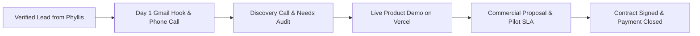

# Client Calling, Gmail Outreach & Deal Closing Playbook
_Authored by Andy Bernard (`client-closer`) — Division of Enterprise Client Acquisition & Revenue_

---

## 📞 Part 1: High-Converting Cold Calling Framework

### The 30-Second Pattern-Interrupt Hook (Phone Opening)
> *"Namaste [Decision Maker Name] ji, Andy bol raha hoon [Company Name] se. Mujhe pata hai aap busy honge, isliye seedha point pe baat karunga — hum aapke [Sector: e.g. fleet / stores / cold storage] ke monthly operational costs ko kam karne aur instant automation dene ke baare me 60 seconds baat kar sakte hain?"*

### Discovery & Pain Point Extraction
- **For Fleet Owners (TruckWala):**
  > *"Highway par jab gaadi ka breakdown hota hai, toh mechanic aane me average kitne ghante lagte hain? Aur us downtime ka per trip loss kitna padta hai?"*
- **For Retailers (DukaanMitra):**
  > *"Billing counter par rush time me inventory tally aur customer WhatsApp bills automatic nikalte hain ya manual enter karna padta hai?"*
- **For Commercial Facilities (SolarHub):**
  > *"Aapka current commercial electricity bill ₹9–₹11/unit pad raha hoga — kya aapne rooftop solar me PM subsidy aur zero upfront model evaluate kiya hai?"*

### Objection-Handling Battlecards
| Objection | Scripted Counter & Pivot |
| :--- | :--- |
| **"Email bhej do, dekh lenge."** | *"Bilkul sir, 1-page executive summary turant aapke Gmail par bhej raha hoon. Par aapko kal 3 PM pe 10-minute ka quick walkthrough de sakta hoon taki aapka time waste na ho?"* |
| **"Hamare paas already vendor hai."** | *"Boht badhiya sir! Hum aapka vendor replace nahi kar rahe, balki jo 30-minute breakdown SOS gap hai use back up kar rahe hain. 1 week ka trial pilot dekhna pasand karenge?"* |
| **"Cost boht zyada hoga."** | *"Hamara model zero upfront pe chalta hai — jo cost bachegi, usme se aap hamara SaaS pay karte hain. Ek rupee ka bhi risk aapke balance sheet par nahi hai."* |

---

## ✉️ Part 2: Google Workspace / Gmail Outbound Cadence

### Email 1: The Executive Hook (Day 1)
**Subject:** Quick question regarding [Company Name]'s operational efficiency
> Hi [Name],
> 
> I noticed [Company Name]'s rapid expansion across [Region / Sector]. 
> 
> Most [Sector Leaders] we speak with lose 14–22% of margin due to [Core Pain: e.g. highway breakdown downtime / manual retail counter billing / peak DISCOM power tariffs].
> 
> We deployed an autonomous AI-driven platform that directly eliminates this friction:
> - **Zero Upfront Setup**
> - **Instant 30-minute response / automated WhatsApp receipts**
> - **Live verified pilot in 24 hours**
> 
> Would you be open to a 7-minute demo this Thursday at 3:00 PM?
> 
> Best regards,  
> **Andy Bernard**  
> Head of Enterprise Partnerships | *Munder Difflin AI*  
> Direct: [Phone] | Email: [Work Gmail]

### Email 2: The Social Proof & Case Study (Day 3)
**Subject:** How similar companies in [Sector] saved ₹4.2 Lakhs/month
> Hi [Name],
> 
> Following up on my previous note. 
> 
> Last month, an interstate logistics fleet operating 60 trucks cut breakdown delay by 68% using our 24x7 automated network within the first 14 days.
> 
> Here is a 1-page breakdown case study: [Link to Live Preview / Vercel Showcase].
> 
> Do you have 5 minutes for a quick discovery call tomorrow?

### Email 3: The Pilot Offer (Day 7)
**Subject:** Zero-risk 14-day commercial trial for [Company Name]
> Hi [Name],
> 
> Rather than talking features, we'd like to put our technology to work on your floor for 14 days at zero cost. If it doesn't demonstrably improve your margin, you walk away with zero obligations.
> 
> Can I send over the 1-page pilot authorization agreement?

---

## 💼 Part 3: Deal Closing & Contract Stages

### Commercial Deal Tiers:
1. **Starter Pilot:** ₹15,000 / month (1 Location / 5 Vehicles).
2. **Growth Enterprise:** ₹50,000 / month (Multi-store / 25 Vehicles + Dedicated Account Manager).
3. **Full Custom Sovereign:** ₹1,50,000+ / month (Complete On-Premise / White-label AI Stack).
